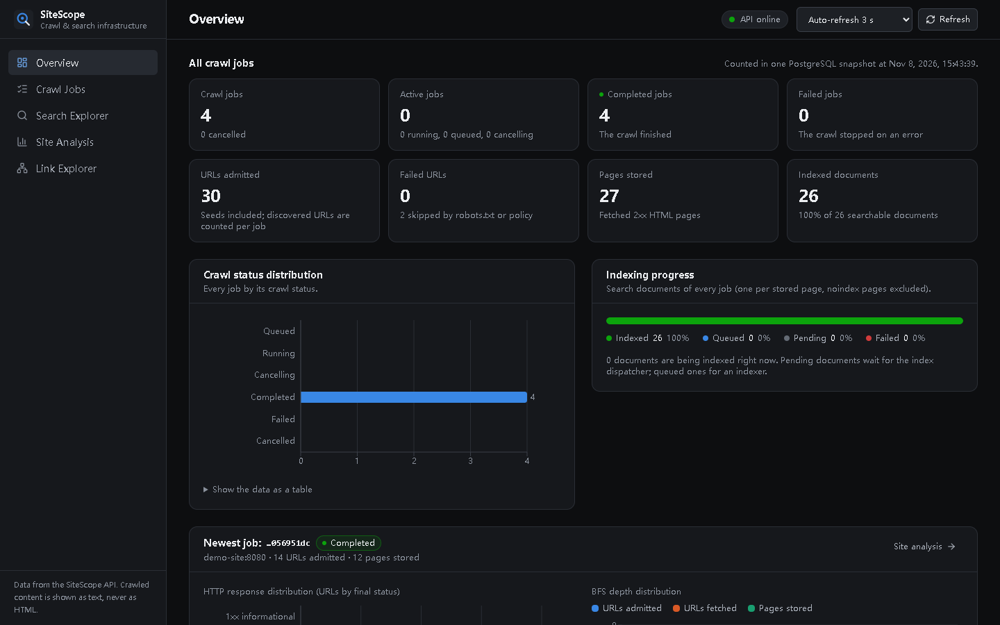
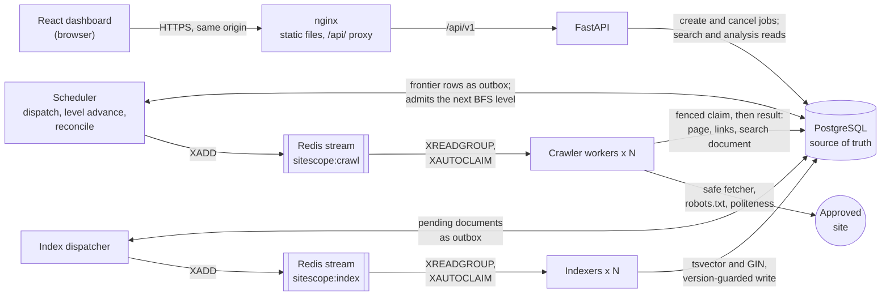
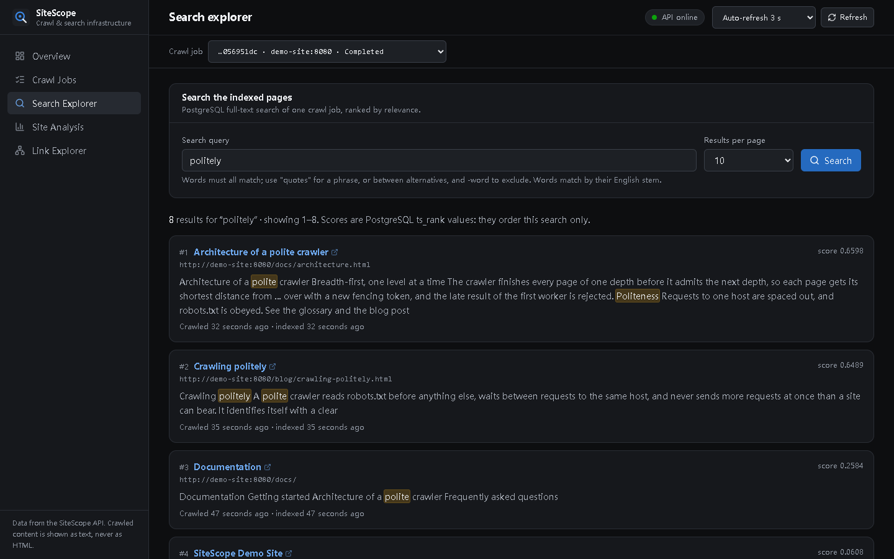
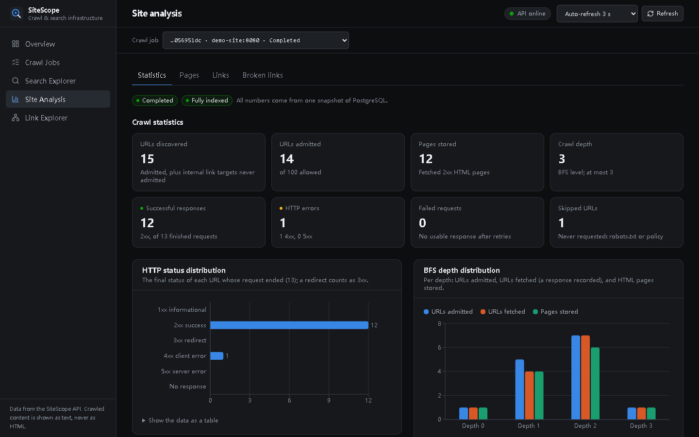
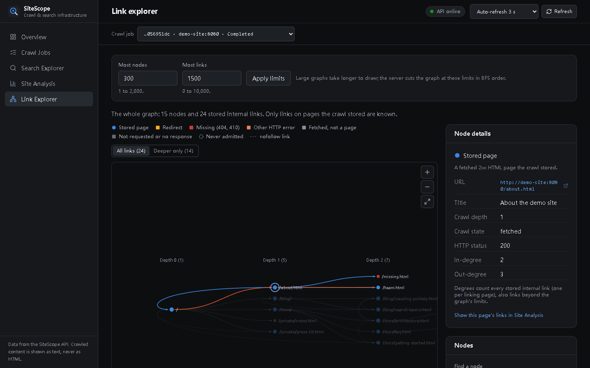
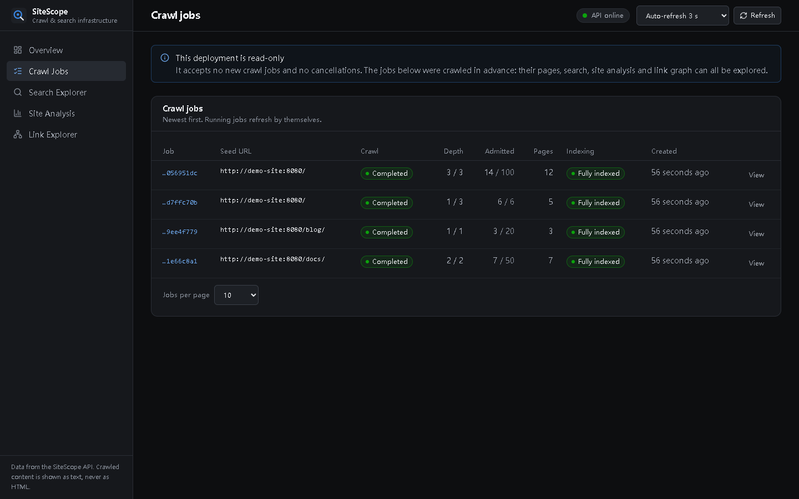
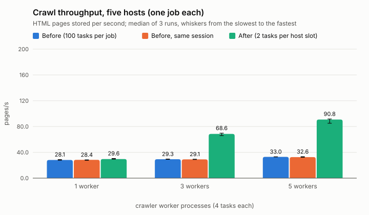
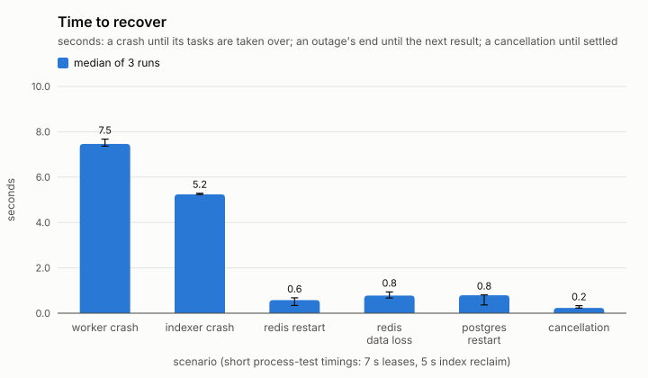

# SiteScope — Distributed Web Crawling & Search Infrastructure

SiteScope crawls approved websites breadth-first with several cooperating processes, indexes
what it fetched for full-text search, and analyses each site's links: status codes, depths,
broken links, and the link graph. A React dashboard shows it all.

It is a portfolio project for backend and distributed-systems engineering. It is small-scale,
runnable and tested under failure: duplicate deliveries, worker crashes, lease expiry, and Redis
or PostgreSQL outages. It is not production-proven, and it has not run at internet scale.

**Highlights**

- **A distributed pipeline.** A scheduler, crawler workers, an index dispatcher and indexers run
  as separate processes and share work through Redis Streams consumer groups. PostgreSQL is the
  single source of truth: Redis can lose all its data without losing work.
- **Correct under failure.** At-least-once delivery with idempotent effects, the state row as a
  transactional outbox, and lease fencing tokens enforced by the database (a CHECK constraint
  and triggers). Fault tests kill, freeze and cut off real processes.
- **Search and analysis.** Asynchronous, version-guarded indexing into PostgreSQL full-text
  search (weighted `tsvector`, GIN), HTTP status distributions, confirmed broken links and an
  interactive link graph.
- **Measured, not assumed.** Profiling found two bottlenecks. Fixing them raised five-worker
  crawl throughput from 32.6 to 90.8 pages/s in a controlled benchmark on one laptop; the raw
  output is committed ([Benchmarks](#benchmarks)).
- **Tested.** Over 2,100 backend tests (unit, integration against real PostgreSQL and Redis, and
  fault injection with real processes), 175 dashboard tests, and Playwright end-to-end tests of
  the whole stack ([Tests](#tests)).



## Contents

1. [The problem](#the-problem)
2. [Features](#features)
3. [Architecture](#architecture)
4. [How it works](#how-it-works)
5. [Technology](#technology)
6. [Run it with Docker](#run-it-with-docker)
7. [Develop locally](#develop-locally)
8. [Tests](#tests)
9. [Benchmarks](#benchmarks)
10. [Security model](#security-model)
11. [Limitations](#limitations)
12. [Documentation](#documentation)

## The problem

A crawler that runs as one loop on one machine is easy to write. Several workers sharing the
work bring the problems this project is about:

- A message is delivered twice. A worker dies holding a URL. A slow worker finishes after its
  lease expired and another worker redid the job.
- Redis loses its data, or PostgreSQL restarts mid-transaction.
- Two workers discover the same URL at the same moment, and a breadth-first crawl must still
  find each page at its shortest depth.
- A page budget must hold exactly.

SiteScope handles each of these by design, and its tests inject them: at-least-once delivery
with idempotent effects, leases with fencing tokens enforced by the database, and PostgreSQL as
the single source of truth. It never claims exactly-once processing.

## Features

- **Crawling.**
  - Level-synchronous breadth-first search with an exact page budget and depth limit.
  - URL normalization and deduplication enforced by a unique constraint.
  - Redirects, `robots.txt` (RFC 9309), `noindex`/`nofollow`, and per-host politeness.
  - Durable retries with backoff, dead letters, cancellation, and idempotent job creation.
- **A safe fetcher.**
  - Approved targets only.
  - DNS resolution with IP validation, and connections pinned to the validated address.
  - Every redirect validated again.
  - Size limits, timeouts and an overall deadline.
- **Distributed execution.** A scheduler, crawler workers, an index dispatcher and indexers,
  coordinated through Redis Streams consumer groups, with recovery of lost and stuck messages.
- **Search.** PostgreSQL full-text search (`tsvector`, GIN) with ranking and highlighted snippets.
  It is built asynchronously, and an older index never replaces a newer one.
- **Website analysis.**
  - HTTP status and depth distributions, and link classes.
  - Confirmed broken links: only a 404 or 410 observed by the crawl counts.
  - Pages, and the link graph.
- **Dashboard.**
  - Pages: jobs, live progress, search, analysis, and an interactive link graph.
  - API types generated from the OpenAPI document.
  - Crawled content shown as text only.
- **Operations.**
  - Prometheus metrics, process heartbeats, and a status command.
  - Container images, a one-command Compose deployment with a read-only public mode, and CI
    workflows.

## Architecture



- **Asynchronous by design.** The API's only writes are creating and cancelling jobs, in
  PostgreSQL; it never publishes to Redis. The scheduler and the index dispatcher publish tasks from PostgreSQL rows
  (the outbox), and workers consume them from Redis Streams consumer groups. A message carries
  identifiers only: every consumer re-reads the state from PostgreSQL.
- **Deployment.** Every box above is a container. Only the proxy publishes a port. PostgreSQL,
  Redis and the workers sit on an internal network with no route to the internet
  ([ADR-0025](docs/adr/0025-container-packaging-and-deployment-topology.md)).
- **Process roles.** One backend image runs every Python role, each with its own command
  ([ADR-0007](docs/adr/0007-modular-monolith-process-roles.md)).
- **Full design:** [docs/architecture.md](docs/architecture.md).

## How it works

### Distributed processing

Each role is a separate process, and roles scale by adding processes:

- **The scheduler** starts jobs, publishes crawl tasks for the current BFS level, admits the next
  level when a level is done, and reconciles lost work.
- **Crawler workers** claim a URL, fetch it outside any transaction, and record the result.
- **The index dispatcher and indexers** do the same for search documents.

Workers only record the links they find. Only the scheduler admits the next level, under the
job's row lock, which is what keeps BFS depths and the page budget exact
([ADR-0004](docs/adr/0004-level-synchronous-bfs.md)).

### Redis Streams: delivery, not truth

Tasks travel through Redis Streams consumer groups (`XREADGROUP`, `XACK`):

- `XAUTOCLAIM` recovers messages that a dead consumer left pending.
- A message delivered too often goes to a dead-letter stream.
- Streams are trimmed by age, never past an undelivered or pending entry.

A message carries only identifiers. Consumers re-read the state from PostgreSQL, so Redis can
lose everything without losing work: the reconciler republishes whatever PostgreSQL still records
as outstanding ([ADR-0001](docs/adr/0001-postgresql-source-of-truth.md),
[ADR-0016](docs/adr/0016-distributed-execution-redis-streams.md)).

### Recovery from failures

Every failure below is injected by a fault test or a benchmark with real processes:

- **A crashed worker.** Its lease expires and another worker takes its URLs over.
- **A Redis outage, or a restart with no data.** Workers back off and retry, then rebuild the
  stream, the consumer group and the politeness state.
- **A PostgreSQL restart.** The tasks in flight retry.
- **A cancellation.** It settles once the URLs in flight finish.

Retries are durable: a retried URL waits in PostgreSQL (`pending` with `next_attempt_at`), never
in a process's memory ([ADR-0017](docs/adr/0017-retries-dead-letters-cancellation-idempotency.md)).

### Leases and fencing tokens

A worker claims a URL with a compare-and-set that increments `lease_epoch`, its fencing token.
Its result transaction starts with an update guarded by `state = 'in_progress' AND lease_epoch =
:token`. Zero rows means the lease was lost: the worker rolls back, writes nothing, and does not
acknowledge the message.

The database enforces this ([ADR-0010](docs/adr/0010-database-enforced-fencing.md),
[ADR-0011](docs/adr/0011-fencing-tokens-issued-only-by-claims.md)):

- a CHECK constraint ties every outcome to the lease that produced it;
- triggers allow `lease_epoch` to change only in a claim, by exactly one.

A slow worker whose lease expired can therefore never overwrite the result of the worker that
took over.

### Transactional persistence

There are no dual writes. The state row is the outbox
([ADR-0002](docs/adr/0002-transactional-outbox.md)):

- A crawl task is published from its `crawl_urls` row, and an index task from its
  `search_documents` row.
- The dispatchers publish and then mark the row as published, in the same transaction.
- A claim locks the row first, so it waits for any dispatch of that row still in flight.

Other guarantees:

- No transaction spans a request to a crawl target.
- State transitions are conditional updates (`UPDATE ... WHERE state = :expected`).
- Duplicates are prevented by unique constraints, not by check-then-insert.

### Asynchronous indexing

A stored page creates a `pending` search document, and the index dispatcher publishes it.
An indexer then:

1. counts the attempt in PostgreSQL, under an advisory lease, before doing any work;
2. builds the vector inside PostgreSQL from the page row it locks;
3. writes the vector with that page's `content_version`, and only if no newer version is already
   indexed.

Triggers reject any write that would lower the indexed version. A job's indexing is complete
once the crawl is over and no document is pending or queued
([ADR-0018](docs/adr/0018-asynchronous-indexing-pipeline.md)).

### PostgreSQL full-text search

Search uses:

- weighted `tsvector`s: title, then description, headings, and body, in decreasing weight;
- a GIN index;
- queries parsed by `websearch_to_tsquery` (phrases, `or`, `-word`);
- `ts_rank` ordering, and highlighted snippets. It returns only
documents whose index matches the page's current content. Using PostgreSQL instead of a search
engine keeps one source of truth, at the cost of ranking features
([ADR-0005](docs/adr/0005-postgresql-full-text-search.md)).



### Website analysis

Analysis reports only what the crawl observed:

- HTTP status classes, depth distributions, link classes, pages, and the link graph;
- broken links, where a link is broken only if its target, after redirects, answered 404 or 410;
- a target never requested is *unverified*, never broken and never working.

The reads run in one read-only REPEATABLE READ transaction with a time limit, planned with hash
joins so that a job the planner's statistics haven't seen yet cannot make them quadratic
([ADR-0019](docs/adr/0019-website-analysis-from-stored-crawl-results.md),
[ADR-0023](docs/adr/0023-whole-job-statements-use-hash-joins.md)).





### The dashboard

A React and TypeScript single-page app ([ADR-0020](docs/adr/0020-dashboard-same-origin-typed-client.md)):

- **API access.** It calls the API on its own origin, so no CORS is needed. TanStack Query
  holds the server state, typed from the OpenAPI document.
- **Polling.** It polls only while a job can change, and pauses for hidden tabs and stalled
  jobs.
- **Totals.** Totals come only from endpoints that count them.
- **Crawled content.** Titles, snippets and URLs are rendered as text, never as HTML, under a
  strict Content Security Policy.
- **Read-only deployments.** The dashboard shows the read-only notice and no write controls.



## Technology

| Area | Choice |
|---|---|
| API | Python 3.13, FastAPI, Pydantic, uvicorn |
| Persistence | PostgreSQL 18 (SQLAlchemy 2 async, asyncpg, Alembic) |
| Messaging, rate limits | Redis 8 Streams and Lua scripts (redis-py asyncio) |
| Crawling | asyncio, httpcore2 behind a custom safe fetcher, Beautiful Soup |
| Dashboard | React 19, TypeScript, TanStack Query, React Router, Recharts, Tailwind CSS, Vite |
| Tests | pytest (unit, integration, fault injection with real processes), Vitest, Playwright |
| Packaging | Docker multi-stage images, Docker Compose, nginx, optional Caddy for HTTPS |
| CI | GitHub Actions: lint, types, tests, secret scan, image builds, end to end, deployment smoke |

## Run it with Docker

Requirements: Docker Engine with the Compose plugin (2.24 or newer). From the repository root:

```sh
cp deploy/.env.example deploy/.env
# Set the three passwords in deploy/.env (DEPLOY_POSTGRES_OWNER_PASSWORD,
# SITESCOPE_POSTGRES_PASSWORD, SITESCOPE_REDIS_PASSWORD), each to its own value from:
python3 -c "import secrets; print(secrets.token_urlsafe(32))"

docker compose -f deploy/compose.yaml up -d --build --wait
docker compose -f deploy/compose.yaml exec api \
    python -m app.scheduler.admin seed-demo --base-url http://demo-site:8080 --wait 600
python3 deploy/smoke.py http://127.0.0.1:8080 --read-only --demo
```

Then open <http://127.0.0.1:8080>.

- **What starts.** The stack builds three images and starts PostgreSQL, Redis, a one-shot
  migration, the API, the scheduler, two crawler workers, the index dispatcher, two indexers,
  the demo site and the proxy.
- **The demo crawls.** `seed-demo` crawls the bundled demo site, whose content is synthetic and
  written for this project, four times with different limits.
- **Read-only.** Without an admin token, the deployment refuses writes from the network
  (ADR-0024). Jobs are created with the operator commands inside the stack.

Hosting options, HTTPS, backups and upgrades: [docs/deployment.md](docs/deployment.md).

## Develop locally

**The local demo, one command (Windows).** From the repository root, `.\demo.cmd` brings up WSL,
Docker, PostgreSQL and Redis, starts every process on a disposable database, seeds the demo
crawls and serves the dashboard at <http://127.0.0.1:4173>. Ctrl+C, or `.\demo.cmd --stop` from
another terminal, stops it and removes what it created. The development database is never
touched ([docs/development.md](docs/development.md#local-demo-one-command)).

The development setup runs PostgreSQL and Redis in Docker and every Python process from a
virtual environment. On the development machine that is Windows with Docker in WSL; on Linux,
drop the `wsl` prefix. Full guide: [docs/development.md](docs/development.md).

```powershell
cd backend
python -m venv .venv
.\.venv\Scripts\python.exe -m pip install -e ".[dev]"
copy .env.example .env                 # then set the two passwords
wsl docker compose up -d --wait        # PostgreSQL and Redis on 127.0.0.1
.\.venv\Scripts\python.exe -m alembic upgrade head
.\.venv\Scripts\python.exe -m uvicorn app.main:app --reload

cd ..\frontend
npm ci
npm run dev                            # http://127.0.0.1:5173, /api proxied to :8000
```

## Tests

| Suite | Command | What it covers |
|---|---|---|
| Backend unit | `python -m pytest -m "not integration"` | URL rules, the fetcher's policies, parsing, state logic, API contracts. No network, database or Redis |
| Backend integration and fault | `python -m pytest -m integration --require-services` | Real PostgreSQL and Redis on disposable databases. Real scheduler, worker and indexer processes, killed, frozen and cut off from their services. Correctness invariants checked after each run |
| Dashboard | `npm run check` | Type check, lint, format, Vitest component tests against a fake API, production build |
| End to end | `python -m tests.dashboard_stack --e2e` | The whole stack on a disposable database, driven by Playwright |
| Deployment | `deploy/smoke.py` | The containerized stack through its public entry |

The suites never touch the development database or the public internet. Their latest results
are in [docs/development-roadmap.md](docs/development-roadmap.md) (Phase 11), and the CI
workflows are described in [docs/ci.md](docs/ci.md).

## Benchmarks

All measured on one laptop (AMD Ryzen 7 5800U, 16 GB). PostgreSQL and Redis ran in Docker in
WSL 2, alongside every process. The raw results, commands and method are in
[docs/performance.md](docs/performance.md); none of these numbers is a capacity claim for other
hardware.

| Measure | Result |
|---|---|
| Crawl throughput, five hosts, 2,000 pages, 1 / 3 / 5 workers | 29.6 / 68.6 / 90.8 pages/s (before Phase 10's fixes: 28.4 / 29.1 / 32.6) |
| Indexing, 2,000 pages of 1,000 words, 1 / 2 / 4 indexers | 151.9 / 217.0 / 266.3 pages/s |
| Search, 10,000 documents, a term in every document | p50 / p95 / p99: 86.8 / 93.7 / 98.4 ms. A rare term: p50 18.1 ms |
| Next-level admission with stale planner statistics, 977 URLs | 5,174 ms before the fix, 28.7 ms after |
| Recovery, with the tests' short timings (7 s leases) | A killed worker's URLs taken over after 7.5 s. Progress 0.6 s after Redis came back, 0.8 s after PostgreSQL did. A cancellation settled in 0.23 s |

The crawl benchmarks used development politeness settings (4 requests in flight per host, 25 ms
apart). The default is one request per second per host.





## Security model

The full threat model is in [docs/security.md](docs/security.md).

- **Crawl scope.**
  - The crawler reaches approved targets only.
  - Every address is checked after DNS resolution and pinned for the connection.
  - Redirects are revalidated hop by hop.
  - `robots.txt` and per-host politeness are obeyed.
  - Sizes and times are bounded.
- **Network.** In the deployment, the crawlers' network has no route to the internet at all.
- **Writes.** A public deployment is read-only: creating or cancelling a crawl is refused by the
  backend (403), or requires an administrator's bearer token (401 without it). A cap bounds the
  active jobs.
- **The proxy.**
  - It rate-limits each client address.
  - It sends a strict Content Security Policy.
  - It never serves `/metrics` or the API documentation.
- **Containers.** The application's containers (API, scheduler, workers, proxy, demo site) run
  as non-root users with read-only root filesystems and no capabilities. PostgreSQL, Redis and
  Caddy run from their official images' entrypoints.
- **Database access.** The deployed application connects as a role that can read and write rows
  only: not a superuser, not the owner, no DDL.
- **Secrets.** They live in git-ignored `.env` files. CI scans the whole git history with
  gitleaks.

## Limitations

- **Scale.** One machine was measured. Throughput on one host is bounded by politeness by
  design. Crawls of millions of pages, and multi-host deployments, have not been tested.
- **Delivery.** Delivery is at-least-once: a crash can repeat a fetch (bounded by the tasks in
  flight). Effects stay exact, but the target sees the duplicate request.
- **Rendering.** No JavaScript rendering: the crawler sees a page's HTML as served.
- **Search.** PostgreSQL ranking has no relevance tuning, no typo tolerance, and no search
  across jobs.
- **The deployment.**
  - It is one Compose host, which is a single point of failure, with no orchestration.
  - HTTPS through Caddy was validated as configuration only.
  - The stack has not been deployed publicly.
- **The admin model.** One shared admin token, without per-person accounts.
- **CI.** The GitHub Actions workflows have not run on GitHub yet; they were validated locally.

## Documentation

| Document | Contents |
|---|---|
| [docs/architecture.md](docs/architecture.md) | Design, data model, state machines, reliability model, invariants |
| [docs/adr/](docs/adr/README.md) | 25 architecture decision records |
| [docs/deployment.md](docs/deployment.md) | Hosting options and costs, Docker deployment, operations, backups, HTTPS |
| [docs/security.md](docs/security.md) | Threat model, defenses, secret handling, residual risks |
| [docs/performance.md](docs/performance.md) | Benchmarks: method, results, before and after |
| [docs/observability.md](docs/observability.md) | Metrics, heartbeats, the status command |
| [docs/development.md](docs/development.md) | Local setup and commands (Windows, WSL Docker) |
| [docs/api-conventions.md](docs/api-conventions.md) | URLs, request IDs, problem details |
| [docs/ci.md](docs/ci.md) | The CI workflows |
| [docs/development-roadmap.md](docs/development-roadmap.md) | The phases and their status |

## License

MIT ([LICENSE](LICENSE)). Third-party software, including Redis' licensing: see
[THIRD_PARTY_NOTICES.md](THIRD_PARTY_NOTICES.md).
