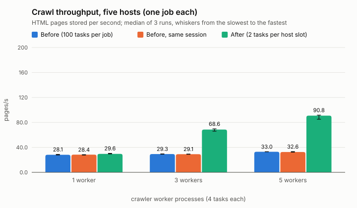
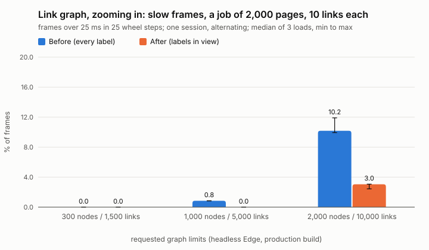

# Performance and reliability (Phase 10)

What SiteScope does under load and under failure, measured on one development machine. Every number
below comes from a run in this repository: its command is in [`benchmarks/README.md`](../benchmarks/README.md),
its raw output in [`benchmarks/results/`](../benchmarks/results/) (JSON, plans as text, CSV summaries),
and its charts are computed from those files (`benchmarks/charts.py`). Nothing is extrapolated, and
no number is a capacity claim for another machine. Observed results, hypotheses and confirmed causes
are labelled as such.

## Method

- **Machine.** AMD Ryzen 7 5800U laptop (8 cores, 16 threads, nominal 1.9 GHz), 15.3 GB RAM,
  Windows 10 Home 10.0.19045, on AC power, High performance power plan. PostgreSQL 18.6 and
  Redis 8.10.3 run in Docker inside WSL 2 (Ubuntu 24.04, 16 vCPUs, 7.4 GB), reached through WSL's
  localhost forwarding; PostgreSQL with its image's defaults (`shared_buffers` 128 MB, `work_mem`
  4 MB, `synchronous_commit` on, `fsync` on), Redis with append-only persistence. Every process
  (API, scheduler, workers, indexers, the benchmark itself with the test sites) and both databases
  share the machine.
- **Isolation.** A disposable database per benchmark, Redis database 15 under fresh key prefixes,
  sites on loopback addresses; the development database was checked unchanged before and after
  (fingerprint `e574f91fa587b2ea`, revision 0004).
- **Repetition.** Three trials per configuration unless stated otherwise, interleaved (trial by
  trial, every configuration once), medians reported with the range of the trials. No run was
  discarded.
- **Before and after.** The code before Phase 10 (commit `37ee301`) ran from a `git worktree`,
  alternating run by run with the Phase 10 code in the same session (`--variant`).
- **Samplers** (per run): the machine's CPU load and effective clock (`% Processor Performance`:
  above 100 means boost; `% Performance Limit` stayed at 100 in every sample: no power or thermal
  limit was reported), the WSL VM's and the PostgreSQL and Redis containers' CPU, every process's
  CPU time and memory, PostgreSQL's statistics (commits, buffer hits, deadlocks) and sessions
  (connections, lock waits).
- **Timings.** The process tests' short timings (`tests/process_support.FAST_TIMING`: 7 s leases,
  0.1 s scheduler passes, 0.2 to 1 s retry backoff). Politeness in the crawl benchmarks: 4
  requests in flight per host, 25 ms between request starts (development-only values; the
  defaults are 1 request per host, 1 s apart).

## Crawling

`benchmarks/crawl_scaling.py`, workloads of `benchmarks/workloads.py` (seed 2026): sites of 100 to
2,000 pages in BFS levels 0 to 4 with nested, cyclic and duplicate links, 3 % of pages also behind
a 301, 2 % linking to a 404, 2 % answering 503 once, 0.5 % always answering 500, delays of 40 ms
(75 %), 120 ms (20 %) and 300 ms (5 %), bodies of 4 KB to 120 KB. Workers run 4 tasks each.
Throughput is HTML pages stored per second, from creating the jobs to the last job's end. Every
run was checked against the workload's expected counts (admitted URLs, stored pages, redirects,
HTTP errors, retries, requests per page) and every job against the correctness invariants: all
runs passed.

### Before Phase 10: workers did not scale (observed)

Five hosts, 400 pages each, one job per host (`phase10-crawl-multi-host-baseline.json`):

| Workers | Pages/s, median (range) | Seconds | Dispatch-to-result p50 | Each host idle |
|---|---|---|---|---|
| 1 | 28.1 (27.8 to 28.8) | 70.9 | 12.4 s | 80 % |
| 3 | 29.3 (29.1 to 29.6) | 68.1 | 12.0 s | 77 % |
| 5 | 33.0 (32.9 to 33.1) | 60.5 | 10.7 s | 74 % |

Five independent hosts, each allowing 4 requests at a time, were crawled about one at a time: the
servers' own request timelines show each host idle three quarters of the time, with 0.41 to 0.47
requests in flight on average out of 4 (medians of the runs). Meanwhile 98 % of the workers' task
slots were busy, and a task's median time grew from 109 ms (1 worker) to 637 ms (5 workers): the
tasks were waiting for politeness slots. CPU was not the limit: each worker used 0.13 to 0.41
cores, PostgreSQL 0.2 to 0.28, and the machine's processor utility was 37 to 44 %.

One host, 1,000 pages (`phase10-crawl-single-host-baseline.json`): 26.6, 16.0 and 15.8 pages/s
for 1, 3 and 5 workers (medians), with runs either near 26 or near 16 pages/s.

Size sweep, five hosts, 5 workers (`phase10-crawl-sizes-baseline.json`): 43.3, 36.4, 32.6 and
33.3 pages/s for 100, 500, 1,000 and 2,000 pages; the median time from a URL's dispatch to its
result grew from 0.19 s to 10.6 s with the backlog.

### Cause 1, confirmed: the dispatch window was far larger than a host can serve

The scheduler kept up to `SITESCOPE_SCHEDULER_MAX_IN_FLIGHT_PER_JOB` = 100 URLs of a job queued or
in progress and published a job's room as one batch, job after job. A job crawls one host, which
the politeness gate lets serve 4 requests at a time here (1 by default). Workers read the stream
in order, so the next 100 messages all belonged to one host: every worker's tasks queued for that
host's 4 slots, holding the workers' task slots, while the other hosts' messages waited behind
them. The tasks of each host were thus crawled almost alone.

**Evidence.** Changing only the setting to 8 (twice the host's slots), on the same code
(`phase10-crawl-multi-host-baseline-inflight8.json`): 31.1 (30.6 to 31.3), 68.6 (66.6 to 71.7)
and 87.6 (84.2 to 88.1) pages/s for 1, 3 and 5 workers; each host idle 27 % of the time with 5
workers; the median dispatch-to-result time 210 ms instead of 10.7 s.

**Fix** ([ADR-0022](adr/0022-dispatch-window-follows-host-politeness.md)): the scheduler limits a
job's queued and in-progress URLs to the smaller of `SITESCOPE_SCHEDULER_MAX_IN_FLIGHT_PER_JOB`
and `SITESCOPE_SCHEDULER_TASKS_PER_HOST_SLOT` (default 2) times the host's politeness slots.
Regression test: `tests/integration/test_scheduler.py` (two jobs get 8 tasks each, not 100 and 0).

### Cause 2, confirmed: a BFS level transition could take 18 to 22 s

In 6 of 9 single-host runs, in both configurations, the time between a level's last result and
the next level's first dispatch was 18 to 22 s instead of about 0.15 s, once or twice per run:
that, not the workers, made the slow runs slow. The multi-host and size runs never showed it.

**Diagnosis** (`benchmarks/gap_monitor.py`, raw output `phase10-admission-gap-monitor.txt`;
`phase10-crawl-single-host-gap-probe.json`): during a gap, the scheduler's session was `active`,
waiting for nothing, running the level admission statement for over 7 s. Its plan, from the
statistics PostgreSQL had then, estimated every row of the new job at 1 (the statistics described
the previous run's job; the table's row count was unknown after `TRUNCATE`) and chained nested
loops whose inner sides scanned the whole job, with the join conditions as filters: about the
number of links times the number of URLs times the number of pages. A fresh database (no
statistics at all) gave a good plan, which is why the slow runs were the later ones.

**Reproduction in isolation** (`benchmarks/admission_plans.py`: an earlier job analyzed, a new
job's levels stored without analyzing, autovacuum off on the three tables so that nothing
analyzes behind the benchmark's back, `EXPLAIN (ANALYZE)` of the admission in a rolled-back
transaction, 3 runs each; `phase10-admission-plans.json`, `-large.json`, and for the largest job
`phase10-analysis-reads-job11k.json`):

| Admitting | Statistics | Nested loops allowed (before) | Nested loops off (after) |
|---|---|---|---|
| 977 URLs from a 222-URL level (1,332 links) | stale | 5,174 ms | 28.7 ms |
| | fresh (`ANALYZE`) | 29.6 ms | 28.9 ms |
| 11,866 URLs from a 1,393-URL level (22,220 links) | stale | over 60 s (statement timeout) | 346 ms |
| | fresh | 342 ms | 333 ms |
| 52,059 URLs from an 11,233-URL level (a job of 11,111 pages, 222,220 links) | stale | over 60 s (statement timeout) | 1,922 ms |
| | fresh | 1,843 ms | 1,836 ms |

The same URLs were admitted in every variant. The output records what the planner knew: in the
stale arm `reltuples` still counted the earlier job only (2,200 URLs, 24,000 links) and no
analyze ran (`autoanalyze_count` 0). A first run with autovacuum left on
(`phase10-admission-plans*-autovacuum-on.*`, found by the review) measured the same admission
times, but autovacuum analyzed the tables during its 60 s timeout, so the arms after it were not
stale any more; its read timings are not used below.

This is not only a benchmark artifact: on a fresh deployment, once the first job is analyzed,
every later job is unknown to the statistics until autovacuum analyzes again (after enough
changes, within about a minute), so its large levels would stall.

**Fix**: the admission runs with `SET LOCAL enable_nestloop = off` (and back to the default right
after it, in the same transaction): hash joins are linear in the job's size whatever the
estimates. Regression test: `tests/integration/test_admission_plan.py` (an earlier job analyzed,
a new job's 200-page level stored since): the admission's plan nests loops when planned freely
and does not under the setting, and the service runs the admission under the setting and
restores it right after. It checks plans and statements, not time, so a loaded machine cannot
fail it; without the fix it fails (the statement is not preceded by the setting), and in its
first, timed form the unfixed admission took 8.6 s for this size.

**Cost of the fix.** With fresh statistics, the hash-join plan measured the same as the
planner's own choice (29 against 30 ms, 333 against 342 ms above). Its work is linear in the
whole job, not in the level being admitted: each admission joins all of the job's stored links,
pages and URLs. In a tree that grows level by level the last level dominates the job, so that is
little more than the level itself (the 11,111-page job: 1,836 ms with hash joins, 1,843 ms with
the planner's own plan, fresh statistics); a site whose levels do not grow would
pay more per level, at most `max_depth` levels (5 by default). In a database of many jobs the
plan reads the job's rows through the `job_id` indexes (bitmap scans), not whole tables:
`db_queries.py` measured an admission over a 5,000-page job in a database of 11 jobs, 50,000
pages and 1,000,000 links at 23.6 ms (the median of 30), every table read through its `job_id`
index.

### After Phase 10 (before and after in one session)

The code before Phase 10 (`37ee301`, default settings) and the Phase 10 code ran alternately, run
by run, three trials each (`phase10-crawl-multi-host-ab.json`, `phase10-crawl-single-host-ab.json`;
chart: `benchmarks/results/charts/crawl-multi-host.svg` and `crawl-single-host.svg`). Every run
passed every check.

| Five hosts, 2,000 pages | Before: pages/s (range) | After: pages/s (range) | Change of the medians |
|---|---|---|---|
| 1 worker | 28.4 (27.7 to 28.4) | 29.6 (29.5 to 30.5) | +4 % |
| 3 workers | 29.1 (28.9 to 29.4) | 68.6 (66.0 to 69.7) | x 2.36 |
| 5 workers | 32.6 (32.3 to 33.3) | 90.8 (85.2 to 91.7) | x 2.79 |

| One host, 1,000 pages | Before: pages/s (range) | After: pages/s (range) | Runs with a level gap over 2 s |
|---|---|---|---|
| 1 worker | 18.0 (17.9 to 26.5) | 26.6 (26.5 to 26.9) | 2 of 3 before, 0 after |
| 3 workers | 16.1 (16.1 to 16.1) | 22.7 (22.7 to 22.8) | 3 of 3 before, 0 after |
| 5 workers | 16.1 (16.1 to 16.2) | 22.7 (22.5 to 22.8) | 3 of 3 before, 0 after |

The single-host "before" medians differ from the earlier baseline session (26.6 with 1 worker
there): the slow plan struck 2 of 3 runs here and 1 of 3 there; which runs it strikes is
unpredictable, which is why both sessions are reported. After the change the largest gap between
levels was 0.18 s, and the runs agree within 1 % of each other.

Where a task's time goes after the change (medians of the runs' per-task medians, from the
Phase 10 `task.handled` fields; five hosts, 5 workers): queue delay 77 ms (dispatch to claim,
PostgreSQL clock), claim 16 ms, crawl phase 97 ms (of which politeness wait 25 ms), record 32 ms.
With 1 worker the queue delay is 1.0 s (more tasks are dispatched than one worker can start) and
with 3 workers 0.26 s.

### What scales and what does not

- **Across hosts, workers scale until the machine does not** (observed): 29.6, 68.6 and 90.8
  pages/s with 1, 3 and 5 workers on five hosts. With 5 workers the hosts were still idle 24 % of
  the time, while the machine's processor utility reached 75 % and its effective clock fell from
  148 % to 112 % of nominal: on this laptop the workers, PostgreSQL (0.96 cores) and the test
  servers compete for the same cores. The bound with more workers here is the machine, not the
  design.
- **On one host, the host's politeness is the bound** (observed): 26.6 pages/s with 1 worker
  (4 tasks fill the host's 4 slots; the 25 ms spacing allows at most 40 starts per second). More
  workers cannot raise it, and cost 15 % (22.7 pages/s with 3 or 5 workers): the extra tasks wait
  for a slot (median 135 ms). The likely reason is that a freed slot waits for the next poll of a
  waiting task (the politeness gate polls every 100 ms when it cannot tell when a slot frees);
  this was not confirmed by changing the poll interval. With the production
  default of one request per second per host, one host is crawled at about one page per second
  whatever the number of workers.
- **Job size** (5 workers on five hosts; `phase10-crawl-sizes-baseline.json` before,
  `phase10-crawl-sizes.json` after, chart `benchmarks/results/charts/crawl-sizes.svg`; two sessions about an hour
  apart, not interleaved, so read the trend rather than small differences):

  | Pages (five hosts together) | Before: pages/s (range) | After: pages/s (range) | After: host idle |
  |---|---|---|---|
  | 100 | 43.3 (42.1 to 44.0) | 42.3 (40.9 to 45.0) | 57 % |
  | 500 | 36.4 (36.4 to 36.4) | 76.9 (76.7 to 77.3) | 35 % |
  | 1,000 | 32.6 (32.3 to 32.9) | 84.7 (82.2 to 85.7) | 27 % |
  | 2,000 | 33.3 (33.0 to 33.3) | 92.2 (89.1 to 93.9) | 23 % |

  Before, throughput fell as jobs grew (the backlog of one host's tasks grew with them). After,
  it rises with size: each job has five BFS levels whatever its size, and each level transition
  costs a scheduler pass or two (the largest gap between levels was 0.23 to 0.28 s in every
  run), which a larger job spreads over more pages. At 100 pages (20 per host) the jobs are mostly
  level transitions, and the change makes no difference. The 2,000-page result agrees with the
  interleaved comparison above (90.8 there, same configuration).

## Database queries

### The pipeline's statements and the dashboard's snapshot reads

`benchmarks/db_queries.py` (`phase10-db-queries.json`, plans in `phase10-db-plans.txt`): a
database of 11 jobs (10 completed jobs of 5,000 pages with 20 links each, and a running job
with a frontier of 2,000 URLs): 57,001 URLs, 50,000 pages, 1,000,000 links, 50,000 search
documents, 365 MB. Each statement: `EXPLAIN (ANALYZE, BUFFERS)`, then 30 timed executions in
rolled-back transactions; the dashboard's reads are executed through their services and every
statement they ran is explained.

| Statement | In PostgreSQL (`EXPLAIN ANALYZE`) | p50 with the round trip | How it reads |
|---|---|---|---|
| claim a URL: row lock, then the fenced update | 0.03 ms, 0.30 ms | 1.1 ms, 1.3 ms | `pk_crawl_urls` |
| inspect a URL (a redelivered message) | 0.03 ms | 1.1 ms | `pk_crawl_urls` |
| dispatch: select a job's due URLs | 0.88 ms | 1.7 ms | `ix_crawl_urls_unfinished` |
| has unfinished URLs; running frontiers; outstanding tasks; reconciliation scan | 0.03 to 0.74 ms | 1.1 to 1.4 ms | `ix_crawl_urls_unfinished` |
| admit a level (a 5,000-page job, hash joins) | 45 ms | 23.6 ms | bitmap scans of the job through its `job_id` indexes |
| index dispatch: select pending documents | 8.3 ms | 7.8 ms | `ix_search_documents_pending`, `pk_pages` |
| job list (first page of 20) | | 3.3 ms | `crawl_jobs` (11 rows: a sequential scan) |
| job detail | | 5.3 to 7.2 ms | the job's rows through `job_id` indexes |
| `GET /metrics` snapshot; `GET /api/v1/overview` snapshot | | 26.1 ms; 26.1 ms | sequential scans of `crawl_urls` and `search_documents` |

- Every statement that reads a few rows uses an index; the round trip through WSL's port
  forwarding (about 1 ms) dominates them. The small `crawl_jobs` table is read sequentially,
  which is the planner's right choice at 11 rows.
- The deployment-wide counts of `/metrics` and the overview read whole tables by design
  (ADR-0021): 26 ms here, linear in the deployment's data.
- **Page persistence** (the crawl's result transaction: the fenced update, the page, its links,
  events) is measured in the crawl runs as the `record` stage: 17.6 ms at the median with one
  worker on five hosts, 31.5 ms with five (more transactions in parallel on the same database).
- **No index was added**: none of these statements needed one.

### Per-job statements when the statistics have not seen the job

The level admission (Cause 2 above) and the analysis reads share a cause: PostgreSQL plans from
statistics that may not have seen a new job (ADR-0023). `admission_plans.py` timed every
analysis read as the API calls it, with stale and with fresh statistics, before the change
(`phase10-admission-plans*.json`) and after it (`phase10-analysis-reads*.json`), and explained
every statement with nested loops allowed and off. Milliseconds, median of 3; "limit": stopped by
the 10 s analysis time limit, which the API answers with HTTP 503.

**With stale statistics** (the problem), before and after:

| Read | 372 URLs, 1,332 links | 2,302 URLs, 22,220 links | 15,887 URLs, 222,220 links |
|---|---|---|---|
| statistics | 5,597 → 16.6 | limit → 97.9 | not run → 1,020 |
| links of class "broken", first 50 | 5,802 → 11.9 | limit → 69.6 | not run → 714 |
| broken links, first 50 | 314 → 10.5 | limit → 17.6 | not run → 84.6 |
| pages, first 50 | 14.3 → 6.6 | 225 → 8.2 | limit → 22.1 |
| pages after a deep cursor | 13.0 → 6.4 | 12.1 → 8.0 | limit → 19.0 |
| links, first 50 | 17.8 → 9.9 | 245 → 27.8 | limit → 216 |
| links after a deep cursor | 18.4 → 8.4 | 278 → 20.3 | limit → 134 |
| one page's links | 12.2 → 7.4 | 229 → 15.6 | limit → 113 |
| graph, 500 nodes | 68.2 → 60.4 | 107 → 91.5 | 605 → 496 |
| graph, 2,000 nodes | 96.6 → 68.0 | 627 → 109 | 2,820 → 417 |

For the largest job, "before" comes from a first run with only the reads that classify every
link changed (`-step1`): its other reads still ran the earlier code, and the classifying ones were
not run with it ("not run"; at 2,302 URLs they already reached the limit). The statement plans
of the final run show the cause: with stale statistics and nested loops allowed, the slowest
statement of the statistics read took 7,743 ms for the smallest job and 9,396 ms for the middle
one, against 4 ms and 61 ms with them off; for the largest job, three statements of the
statistics read and the first pages of pages and of links ran into the limit with nested loops
allowed (`read_plans` in each file).

**With fresh statistics** (the cost of the change):

| Read | 372 URLs | 2,302 URLs | 15,887 URLs |
|---|---|---|---|
| statistics | 15.3 → 16.2 | 76.0 → 80.1 | not run → 693 |
| links of class "broken", first 50 | 11.0 → 10.4 | 31.2 → 36.1 | not run → 243 |
| broken links, first 50 | 10.5 → 10.9 | 20.2 → 32.3 | not run → 191 |
| pages, first 50 | 7.6 → 7.3 | 10.2 → 11.5 | 32.4 → 36.1 |
| links, first 50 | 8.5 → 9.4 | 7.6 → 27.2 | 10.1 → 213 |
| links after a deep cursor | 8.1 → 9.0 | 7.6 → 23.1 | 9.7 → 168 |
| one page's links | 8.0 → 7.9 | 7.3 → 17.3 | 8.8 → 108 |
| graph, 2,000 nodes | 68.2 → 68.6 | 120 → 126 | 285 → 311 |

Most reads cost the same. A page of links pays: it now joins all of the job's links instead of
reading one page through the indexes (213 ms instead of 10 ms for 222,220 links). That is the
trade ADR-0023 makes: a bounded cost that grows with the job, instead of an HTTP 503 whenever
the statistics lag.

## Indexing

`benchmarks/index_scaling.py` (`phase10-indexing.json`, chart `benchmarks/results/charts/indexing.svg`): the Phase 7
dataset (one job of 2,000
pages with 1,000-word bodies, seed 7), stored in one transaction; the clock starts at that commit
(PostgreSQL's clock) and stops at the last `indexed_at`. Indexers run 4 tasks each. Each
configuration ran three times, interleaved, with the GIN index's `fastupdate` on (PostgreSQL's
default, and SiteScope's) and off. Every document was indexed on its first attempt in every run;
no retry, no failure, no deadlock.

| Indexers | `fastupdate` on: pages/s (range) | `fastupdate` off: pages/s (range) | Per-page work p50 (start + index) | Processor utility | Effective clock |
|---|---|---|---|---|---|
| 1 | 151.9 (151.5 to 153.7) | 143.5 (142.9 to 144.6) | 9 + 13 ms | 47 % | 141 % |
| 2 | 217.0 (198.5 to 217.3) | 193.5 (189.6 to 205.1) | 13 + 18 ms | 66 % | 119 % |
| 4 | 266.3 (245.3 to 267.8) | 236.7 (228.1 to 238.9) | 20 + 28 ms | 94 % | 104 % |

(Utility and clock: the `fastupdate` on runs; the off runs differ by at most 2 points.)

- **Where the limit is** (observed). One indexer process used 0.88 cores at 152 pages/s, about
  5.8 ms of its own CPU per page, close to one core for a single-threaded Python process; its
  work per page is small (two transactions: a 9 ms attempt start and a 13 ms indexing statement),
  so most of its time per page is its own CPU. Where in the process that CPU goes was not
  profiled. With four indexers each still used about 0.82 cores, PostgreSQL 2.9 cores (it builds
  every vector), the machine's processor utility reached 94 % and its clock fell from 141 % to
  104 % of nominal: the per-page stages grew from 22 to 48 ms. Throughput grew 1.43 times with
  two indexers and 1.75 times with four: on this laptop the bound is the machine's CPU.
- **Latency.** All 2,000 pages are committed at once, so a page's latency is mostly its wait in
  that backlog: queue delay p50 6.4 s with one indexer, 3.0 s with four; the work itself is the
  per-page column above.
- **GIN maintenance.** `fastupdate` on was faster in every interleaved pair of runs (6 to 13 %
  by the medians): new entries go to the index's pending list, and an insert that fills the list
  merges it (the slowest indexing statement took 233 to 250 ms with four indexers, against 81 to
  91 ms with `fastupdate` off). After a run, 0 to 340 pending pages were left for searches to
  scan until the next merge (`pgstatginindex`), and the index measured 5.6 to 6.4 MB against 1.5
  to 1.7 MB with `fastupdate` off (pages that held the pending list stay in the index's file).
  Not changed: the default writes faster. Searching an unmerged pending list was not measured
  (the search benchmark vacuums before it measures).
- **Database pressure.** At most 18 connections (four indexers with their pools, the
  dispatcher, the benchmark), a lock wait in 1 of 358 half-second samples, 0 deadlocks, a buffer
  cache hit rate of 100 %, about 2.2 commits per page (attempt start, indexing, the dispatcher's
  batches).

**Run-to-run variation** (the Phase 7 question). Phase 7 measured the same dataset at 191.7,
221.4 and 255.4 pages/s in one session and 127.3, 169.4 and 211.6 in another, an hour later,
without samplers. Here, interleaved trials of one configuration agree within 1.5 % (one
indexer) to 9 % (two and four), and the slower trials coincide with a lower effective clock and
more PostgreSQL CPU per page (two indexers, `fastupdate` on: 217.3 pages/s at 118.9 % clock and
1.42 PostgreSQL cores; 198.5 at 116.1 % and 1.82). Throughput tracks the CPU's state; the
samplers make that visible, but the Phase 7 spread itself cannot be measured again, so its cause
stays a likely explanation (the machine's clock and background load after long test runs), not
a confirmed one. No run here reported a power or thermal limit (`% Performance Limit` 100).

## Search

`benchmarks/search_latency.py` (`phase10-search.json`, plans in `phase10-search-plans.txt`, chart
`benchmarks/results/charts/search-latency.svg`): two
jobs of 2,000 and 10,000 documents (1,000-word bodies, a Zipf-like vocabulary), indexed by the
real pipeline, then `VACUUM (ANALYZE)`; `search_documents` 115 MB, its GIN index 16 MB. Each query
kind ran 200 times after 5 discarded warm-up calls, returning 10 results with snippets, first in
the service, then through `GET /api/v1/search`.

| Query (matches at 2,000 / 10,000 documents) | Service p50 / p95 / p99, 2,000 docs (ms) | Service p50 / p95 / p99, 10,000 docs (ms) | API p50, 10,000 docs (ms) | GIN index used |
|---|---|---|---|---|
| common term (2,000 / 10,000) | 31.9 / 33.4 / 36.1 | 86.8 / 93.7 / 98.4 | 91.2 | no |
| medium term (1,287 / 6,431) | 25.2 / 26.9 / 29.3 | 61.4 / 63.6 / 68.3 | 64.5 | no |
| two terms, both required (1,287 / 6,431) | 28.7 / 31.3 / 33.6 | 76.5 / 80.3 / 86.0 | 79.3 | no |
| either of two terms (1,301 / 6,525) | 26.9 / 28.5 / 31.2 | 68.4 / 73.0 / 77.1 | 72.0 | no |
| three terms (101 / 521) | 16.4 / 18.7 / 19.5 | 22.5 / 24.3 / 26.6 | 25.7 | at 10,000 |
| rare term (45 / 237) | 15.0 / 16.7 / 18.1 | 18.1 / 20.0 / 21.5 | 21.5 | yes |
| very rare term (28 / 142) | 14.8 / 15.9 / 16.9 | 17.5 / 19.3 / 21.0 | 20.4 | yes |
| phrase (2 / 2) | 11.1 / 14.5 / 15.8 | 12.7 / 13.9 / 14.5 | 15.6 | yes |
| no match (0 / 0) | 6.0 / 6.8 / 7.1 | 7.5 / 9.0 / 9.5 | 9.8 | yes |
| stop words only (not searchable) | 5.2 / 5.7 / 5.9 | 6.7 / 7.4 / 8.0 | 9.1 | no query run |

- **Cost follows the matches, not the index** (observed). Ranking must score every match before
  it can return the top ten, so a term in most documents costs about linearly in the job: 32 ms
  at 2,000 documents and 87 ms at 10,000. The planner reads such a job's documents through
  `ix_search_documents_job_id` and does not use the GIN index, which would return almost every
  row anyway; for rare terms and phrases it uses the GIN index, and their time hardly grows with
  the job (15 to 18 ms).
- **Pagination costs nothing extra**: offsets 0 to 1,000 took the same time (32 ms at 2,000
  documents, 87 to 88 ms at 10,000), since every match is ranked first in any case.
- **The API adds 2 to 4 ms** at the median (routing, validation, JSON).
- **Concurrency** (mixed queries over both jobs through the API, 15 s per client count):

  | Clients | Requests/s | p50 / p95 / p99 (ms) | PostgreSQL CPU | API CPU | Connections in use |
  |---|---|---|---|---|---|
  | 1 | 31.7 | 21.6 / 84.4 / 92.8 | 0.76 cores | 0.13 cores | 1 |
  | 4 | 83.3 | 32.4 / 130.9 / 151.8 | 2.96 | 0.46 | 4 |
  | 16 | 115.5 | 117.7 / 282.3 / 308.9 | 6.85 | 0.90 | 10 |

  Every response was a 200. With 16 clients, the API's connection pool (5 plus 5 overflow) held
  10 statements at a time and the other requests waited for a connection; PostgreSQL did most of
  the work (scoring and snippets: 6.85 cores against the API's 0.90; the machine has 8 cores and
  16 threads, and its processor utility was 68 %). Whether the pool or the CPU bounds 115
  requests per second here was not separated.
- **Correctness.** No search code changed in Phase 10. Ranking and ordering, job isolation,
  version visibility (an older index never shown) and the limits are covered by the Phase 7 and 8
  tests, which pass. A first run (`phase10-search-run1.json`) overlapped a type check on the same
  machine and showed API outliers (p95 159 ms for a common term at 2,000 documents); the run
  above was made with the machine otherwise idle.

## Recovery from failures

`benchmarks/recovery.py` (`phase10-recovery.json`, chart `benchmarks/results/charts/recovery.svg`): real processes
with the process tests' short
timings (7 s leases and reclaim idle time, 0.5 s reclaim interval, 5 s index reclaim idle time,
10 s reconciliation), a 156-page site (depth 3, branching 5, pages answered after 0.3 s), 2
crawler workers of 4 tasks, 4 requests in flight per host; three trials of each scenario,
interleaved, the clock starting once the processes run. The outages use disposable containers in
WSL Docker, stopped (`docker stop`) and started 5 s later on the same port; the development
database and Redis are never stopped. Every run ended with the correctness invariants checked,
and all passed; no URL failed or was quarantined in any run.

| Scenario | Recovered (median, range) | Job after the fault | What else happened |
|---|---|---|---|
| Control, no fault | | completed after 15.4 s (15.4 to 15.6) | 156 requests, no retry |
| A worker killed (TerminateProcess) holding 2 to 4 URLs | its URLs taken over 7.5 s (7.4 to 7.7) after the kill | completed 11.2 s (10.3 to 14.3) after the kill | 1 to 3 duplicate fetches: the killed worker's requests, made again; at most 2 attempts per URL |
| An indexer killed holding 2 documents, while 200 pages change | its documents indexed 5.2 s (5.2 to 5.3) after the kill | all 3,000 indexed 20.0 s (17.5 to 20.6) after it | every document at its page's current version, the 200 changed ones at version 2 |
| Redis stopped 5 s (append-only file kept) | first progress 0.6 s (0.3 to 0.7) after Redis answered again | completed 10.1 s (10.0 to 10.4) after that | 4 or 5 URLs retried; 7 worker errors and 3 or 4 failed scheduler passes logged during the outage |
| Redis stopped 5 s, restarted empty | 0.8 s (0.7 to 0.9) | 9.9 s (9.6 to 10.0) | stream, consumer group and politeness state rebuilt; 4 to 6 URLs retried; nothing to publish again (below) |
| PostgreSQL stopped 5 s | 0.8 s (0.4 to 0.8) | 10.2 s (9.7 to 10.6) | the 8 tasks in flight could not record their results: 8 retries and 8 duplicate fetches in every trial; no dead letter |
| Cancellation under load (three jobs, 3 workers) | `cancelled` 0.23 s (0.23 to 0.33) after the cancellation committed | the other two jobs completed | one request started 19 ms after the commit in one trial (a task claimed before it), none in the others; none after the scheduler was restarted; the job stayed `cancelled` |

- The outages lasted 5.5 to 6.5 s, from the end of `docker stop` until the service answered
  again (the 5 s pause, `docker start`, and the first successful request).
- **Duplicates are the price of at-least-once delivery, and they are bounded**: by the tasks in
  flight at the fault (the dispatch window), never more; the job's results stayed exact (the
  invariants: no URL twice, the page budget, fencing).
- **Redis restarted empty, nothing to publish again** (observed). With a window of 8 tasks per
  job and 8 task slots, every dispatched task had been claimed when Redis lost its data, so no
  queued task lost its message (`republished` 0, and the job completed). The reconciliation's
  republish path is exercised by `tests/fault/test_redis_data_loss.py` instead.
- **With the default timings** (derived from the settings, not measured): 90 s leases and a 100 s
  reclaim idle time make a crashed worker's URLs wait 100 to 115 s for their takeover instead of
  about 7.5 s; per ADR-0022, a job whose whole window the dead worker held dispatches nothing
  meanwhile. Lost messages wait for the 300 s reconciliation. Outages are bridged by retries with
  backoff (at most 30 s between passes), whatever the timings.
- A first full run (`phase10-recovery-run1.json`, whose first trial shared the machine with a 7 s
  test run) gave the same picture: takeovers within 0.2 s of these medians, first progress after
  an outage within 0.6 s, completion times within 2.1 s.

## Dashboard: the link graph

`benchmarks/dashboard_graph.py` with `frontend/e2e/graph-performance.spec.ts`: the dashboard's
production build (`vite build`, served by `vite preview` with its `/api` proxy) against the real
API, in the installed Microsoft Edge (headless, Playwright, 1440 x 900), each load in a fresh
browser context. Two jobs: 5,000 pages with 10 links each (the first 2,000 nodes share 4,864
links) and a denser one of 2,000 pages (10,000 links among its 2,000 nodes: the API's limits).
Per load: the API response, the time from navigation until every node is drawn, long tasks,
heap, DOM size, then 40 pointer moves of panning and 25 wheel steps of zooming in (which crosses
the scale where labels appear), with the interval between animation frames meanwhile.

**Measured first** (the code of Phase 9; `phase10-dashboard-graph-ab-before.json`,
`-dense-ab-before.json`):

| Graph (nodes / links drawn) | Response | Drawn (median, range) | Longest task | Heap | DOM elements | Pan frames p50 / p99 | Zoom frames p50 / p95 / slowest |
|---|---|---|---|---|---|---|---|
| 300 / 199 (dense job) | 69 ms | 381 ms (370 to 665) | 72 ms | 8 MB | 3,174 | 16.7 / 17.4 ms | 16.7 / 17.2 / 18 ms |
| 1,000 / 3,487 | 118 ms | 620 ms (582 to 666) | 117 ms | 17 MB | 9,277 | 16.7 / 17.2 ms | 16.7 / 17.3 / 50 ms |
| 2,000 / 10,000 | 143 ms | 888 ms (879 to 907) | 258 ms | 46 MB | 18,278 | 16.7 / 33.4 ms | 16.7 / 33.4 / 83 ms |

- Drawing grows with the graph and stays under a second at the API's limits; the one long task
  (React rendering 2,000 node groups) lasts about a quarter of a second.
- Panning held the display's rate (16.7 ms per frame at the median); ten thousand links are two
  combined paths above 1,500 links, so they do not multiply the DOM.
- **Zooming in was the weak spot**: when the scale crossed the label threshold, all 2,000 node
  groups re-rendered with a label each, and the frames after it, with 2,000 labels drawn, often
  took two intervals: 10 % of the zoom frames over 25 ms with the dense job, 7 % with the other,
  the slowest 50 to 84 ms.

**Change** (small, no rewrite): labels have their own layer, and only the nodes in and around
the view get one (`frontend/src/features/graph/viewport.ts`: the view grown by half its size on
every side, computed again only when the view leaves it; a graph of up to 40 nodes labels every
node). The node layer no longer re-renders when the zoom crosses the threshold. Tests:
`viewport.test.ts` (the region, the nodes it labels), `LinkExplorerPage.test.tsx` (a small graph
labels every node, and a click on a label selects its node).

**Before and after in one session**, alternating (before, after, after, before), by building the
committed component and the new one in turn (`phase10-dashboard-graph-ab-*.json`,
`-dense-ab-*.json`; chart: `benchmarks/results/charts/dashboard-graph-zoom-dense.svg`):

| Zooming in, 2,000 nodes | Frames over 25 ms: before → after (median of 3 loads) | Slowest zoom frame: before → after (median) |
|---|---|---|
| dense job, 10,000 links | 10.2 % → 3.0 % | 67 → 33 ms |
| 5,000-page job, 4,864 links | 7.1 % → 0 % | 67 → 18 ms |
| either job, 1,000 nodes | 0.8 % → 0 % | 33 to 50 → 18 ms |

Drawing, panning, DOM size and heap did not change beyond the runs' spread (drawing the dense
graph: 888 ms before, 928 ms after, ranges 879 to 907 and 888 to 938; the change draws nothing
more at that scale, and the difference was not attributed). The first measurements
(`phase10-dashboard-graph.json`, `-dense.json`, ten hours before `-after.json` and
`-dense-after.json`) showed the same direction, but their frames' base interval differed (18.0
against 16.7 ms), so only the same-session pairs above are used for the comparison.

## Resource use and backpressure

Measured in every one of the 100 Phase 10 crawl runs (all `phase10-crawl-*.json` files; the
samplers of `benchmarks/benchlib.py`):

- **Memory.** A crawler worker's working set peaked at 89 MB and grew by at most 8.2 MB during a
  run; the scheduler peaked at 80 MB. Bodies are capped (`SITESCOPE_FETCH_MAX_BODY_BYTES`, 2 MB)
  and the 120 KB pages of the workloads did not show in the peaks.
- **Redis.** Memory changed by -0.19 to +0.19 MB per run. The stream keeps acknowledged entries
  until the scheduler trims them by age (`SITESCOPE_STREAM_RETENTION_SECONDS`), so after a
  2,000-page crawl it held 2,125 entries (one per dispatch, retries included); trimming bounds it.
  Redis served 0.7 to 4.1 thousand commands per second.
- **PostgreSQL.** At most 27 connections in use (5 workers, the scheduler, the benchmark), never
  near `max_connections` (100). 0 deadlocks in every run, a session waiting for a lock in 7 of
  8,714 half-second samples (at most 3 at once), a buffer cache hit rate of 99.95 % or more.
- **The machine.** `% Performance Limit` stayed at 100 in all 124 runs with machine samples
  (crawling, indexing, search): no power or thermal limit was reported.
- **Queues.** The crawl stream's backlog is bounded by the scheduler: at most
  `SITESCOPE_SCHEDULER_MAX_OUTSTANDING` tasks queued or in progress (1,000), and since ADR-0022 a
  few per host slot per job. The index stream is bounded by `SITESCOPE_INDEX_MAX_OUTSTANDING`.
- **Backpressure added.** Only the dispatch window of ADR-0022, where the measurements showed a
  stability problem (tasks of one host occupying every worker). Nothing else was added: no other
  unbounded growth was observed.
- **Indexing and search.** Four indexers used at most 18 connections; 16 search clients held the
  API's pool at its 10 connections, the others waiting for one (see those sections). The API's
  working set stayed between 88 and 93 MB under that load.
- **Other processes.** The dashboard's heap reached 40 MB with the largest graph (see below).

## Optimizations, before and after

Each change followed the same steps: measure, explain with evidence, make the smallest change,
add a regression test, measure again. Numbers are medians from the sections above.

| Change | Problem measured | Before | After | Regression test |
|---|---|---|---|---|
| Dispatch window follows host politeness ([ADR-0022](adr/0022-dispatch-window-follows-host-politeness.md)) | five hosts crawled about one at a time: 100 tasks of one job in the stream ahead of the others | 28.4, 29.1, 32.6 pages/s with 1, 3, 5 workers | 29.6, 68.6, 90.8 | `test_scheduler.py`: two jobs get 8 tasks each |
| Level admission with hash joins ([ADR-0023](adr/0023-whole-job-statements-use-hash-joins.md)) | level transitions of 18 to 22 s: a quadratic plan from statistics that had not seen the job | 5,174 ms for 977 URLs; over 60 s for 11,866 | 28.7 ms; 346 ms | `test_admission_plan.py`: plan and statements |
| Analysis reads with hash joins (ADR-0023) | the dashboard's analysis reads took seconds, or ran into the 10 s limit (HTTP 503), with the same statistics | stale statistics: statistics 5,597 ms (372 URLs), over the limit (2,302 URLs); a page of links over the limit (15,887 URLs) | 16.6 ms; 97.9 ms; 216 ms (fresh statistics: a page of links 10 → 213 ms at 15,887 URLs) | `test_analysis_read_plans.py`: plan work and statements |
| Graph labels for the nodes in view (dashboard) | zooming in at 2,000 nodes: the frame where labels appear, and many after it, took two intervals or more | frames over 25 ms: 10.2 % (dense job), 7.1 %; slowest 67 ms | 3.0 %, 0 %; slowest 33 and 18 ms (same session, alternating) | `viewport.test.ts`, `LinkExplorerPage.test.tsx` |

Considered and not changed, with the reason:

- **The politeness gate's 100 ms poll** costs about 15 % on one host when more tasks wait than
  the host has slots (development politeness only); at the default one request per second it is
  hidden by the spacing. A notification instead of polling would add a Redis subscription per
  waiting task.
- **The GIN index's `fastupdate`** stays on (PostgreSQL's default): it was faster for indexing in
  every run (see "Indexing").
- **No index was added**: every per-row statement measured used an existing index, and the full
  scans that remain are the deployment-wide counts of `/metrics` and the overview (ADR-0021).
- **The indexer's CPU per page** (about 5.8 ms in the process, close to one core per indexer)
  was not profiled, so no change was made to it.
- **Backpressure**: none beyond the dispatch window; no other unbounded growth was measured
  (see "Resource use").

## Limitations and remaining risks

- **One laptop.** Every process, both databases (in a WSL 2 VM) and the test sites share 8 cores;
  the CPU's boost clock falls as more cores work: on five hosts, where the work ran in parallel,
  the effective clock was 148 to 160 % of nominal with one worker and 110 to 121 % with three or
  five (medians of the runs; the code before Phase 10, which crawled the hosts about one at a
  time, kept 146 to 162 %). Scaling numbers mix the code's scaling with the machine's. Nothing
  here predicts another machine.
- **Synthetic sites on loopback.** No DNS, TLS, internet latency or slow tails beyond the scripted
  delays; WSL's localhost forwarding is in every database round trip.
- **Development politeness.** The crawl benchmarks allow 4 requests per host 25 ms apart; the
  defaults (1 request, 1 s apart) make one host's crawl rate about one page per second whatever the
  number of workers.
- **Polling handoff.** With more tasks than a host's slots, a waiting task learns of a freed slot
  within the politeness gate's 100 ms poll: on one host, 3 or 5 workers reached 22.7 pages/s
  against 26.6 with one (15 % less; the interleaved comparison above). Not changed: at the
  default politeness the one-second spacing hides it.
- **Statistics.** PostgreSQL plans per-job statements from table-wide statistics, which may not
  have seen a new job yet. The level admission and every analysis read now run with hash joins
  (ADR-0023) and were measured with stale statistics. **The search statement was measured with
  fresh statistics only** (the search benchmark analyzes before it measures): searching a job
  that the statistics have not seen yet is untested, and is the next per-job statement to
  measure that way. The job detail was measured with stale statistics too (at most 15 ms); the
  claims and the dispatch read one table through its indexes.
- **The cost of hash joins.** A page of links now joins all of the job's links: 27 ms instead of
  8 ms for 22,220 links with fresh statistics, 213 ms instead of 10 ms for 222,220. Jobs at the
  configurable maximum (100,000 pages) were not measured; the cost grows with the job's links.
- **Recovery times scale with the timings.** The recovery benchmark uses the short test timings;
  with the defaults (90 s leases, 100 s reclaim idle time, 300 s reconciliation) each recovery
  takes correspondingly longer.
- **Headless browser.** The dashboard measurements ran in headless Edge, which may rasterize in
  software: compare the graph sizes with each other, not with a desktop browser. Drawing 2,000
  nodes still takes one long task of about a quarter of a second (React rendering the node
  groups); a canvas renderer would be the next step if that mattered, and was not attempted.
- **Sizes not measured.** Jobs at the configurable maximum of 100,000 pages, and deployments with
  many more jobs than the 11 of the query benchmark, were not measured: the numbers above do not
  extend to them.
- **Small samples where noted.** Crawl, indexing and recovery configurations ran three times
  each; their medians and ranges are reported, not confidence intervals. Search and statement
  timings have 30 to 200 samples each.
- **Comparisons across sessions.** The size sweep's before and after ran an hour apart, not
  interleaved; the crawl and graph comparisons that support a claim ran in one session,
  alternating.
